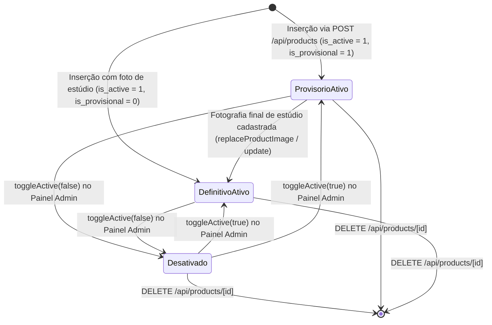
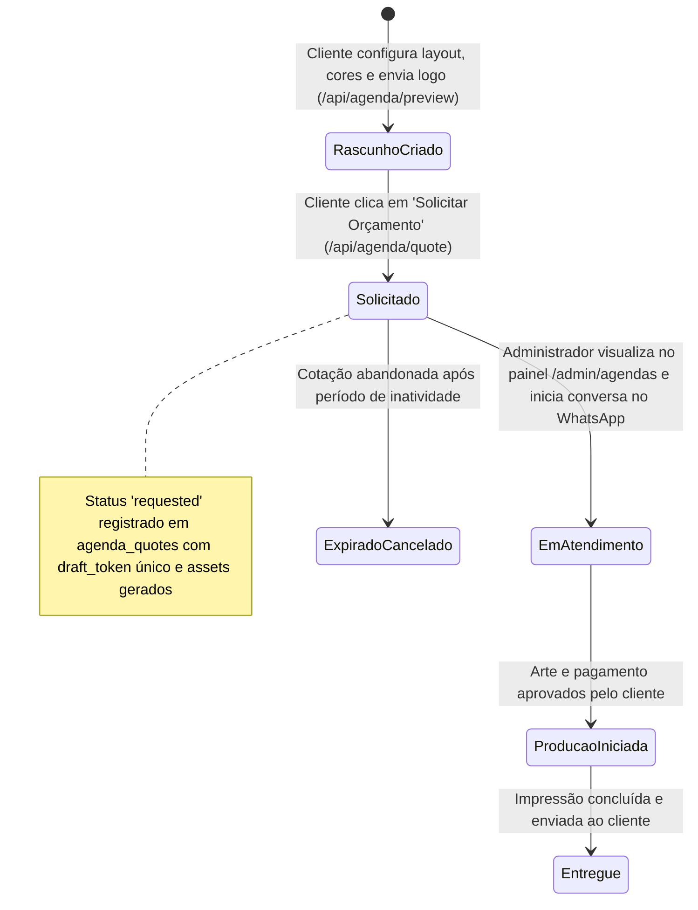
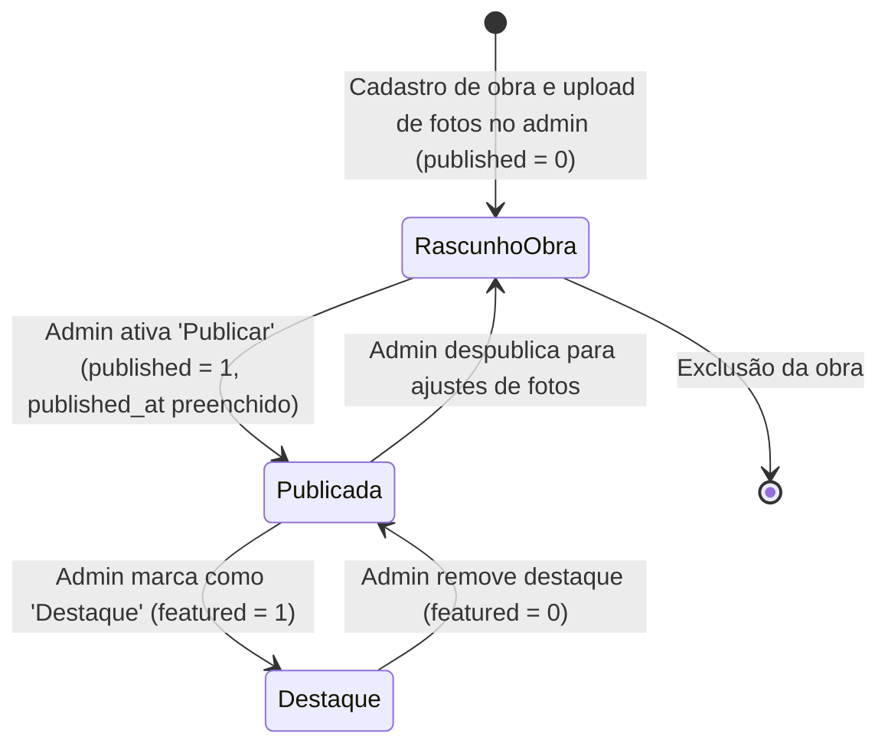

# Máquinas de Estado — 678 Estudio

Documento consolidado gerado na Fase de Interpretação pelo Detective.

---

## 1. Ciclo de Vida do Produto (`Product`)

Os produtos cadastrados no catálogo transitam entre estados de visibilidade e estado de acabamento visual.

### Transições e Gatilhos:
- **`ProvisorioAtivo` → `DefinitivoAtivo`**: Quando a equipe do estúdio fotografa o produto físico real e faz o upload da foto em `/admin`, substituindo a imagem de mockup provisória.
- **`*` → `Desativado`**: Quando o item está temporariamente sem estoque de matéria-prima (ex: falta de cerâmica ou madeira). O item não é excluído, apenas ocultado da vitrine pública.
- **`*` → `Excluído`**: Exclusão definitiva do banco de dados quando a linha é descontinuada.

---

## 2. Ciclo de Vida do Orçamento de Agenda (`AgendaQuote`)

As solicitações de orçamentos de agenda e planner geradas pelo cliente via Typst.

---

## 3. Ciclo de Vida dos Trabalhos do Portfólio (`GalleryWork`)

Obras e fotos de peças personalizadas exibidas na seção `/trabalhos`.

